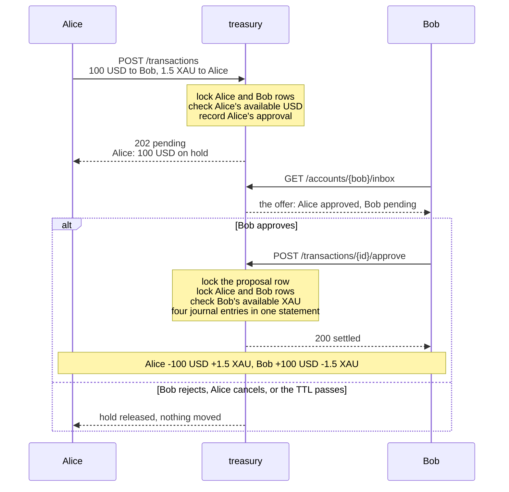

# treasury

An asset ledger with consent-based settlement.

> Alice does not *execute* a swap, she *offers* one. Her funds are reserved the moment she offers;
> Bob's funds move only when Bob approves; and the balances change only at settlement, all legs at
> once or none at all.

The full proposal, with the invariants this service protects, lives in
[`docs/proposal.md`](docs/proposal.md). The entities and their lifecycle are in
[`docs/domain.md`](docs/domain.md).

## Run it

```sh
cp .env.example .env            # set OPERATOR_KEY to any long random string
docker compose up --build       # Postgres on :5433, the API on :8888
```

Without Docker for the app itself: `docker compose up db`, then `cargo run --bin server`.
Migrations run at start-up. The `@issuer` account is created (or its key rotated) from
`OPERATOR_KEY` every time the server starts.

Every request except `GET /health` and `POST /accounts` carries `X-Account-Key`. The operator
key acts as `@issuer`; an account key, returned once by `POST /accounts`, acts as that account.

The OpenAPI document is at `/openapi.json`, an interactive page at `/docs`, and the demo client
from [`web/`](web/) at `/`.

| Variable | Default | Meaning |
|---|---|---|
| `DATABASE_URL` | | PostgreSQL connection string |
| `OPERATOR_KEY` | | the `@issuer` key |
| `SERVER_ADDR` | `127.0.0.1:8888` | listen address |
| `SWEEP_INTERVAL_SECS` | `5` | how often expired proposals are closed in the database |
| `WELCOME_GRANT` | empty | what a new account receives at registration, as `USD=1000,XAU=10` |
| `WEB_DIR` | `web` | directory served at `/`; the API runs alone when it does not exist |
| `RUST_LOG` | `info` | tracing filter |

## API

| Method | Path | Who | What |
|---|---|---|---|
| `POST` | `/assets` | issuer | create `{code, name, scale}` → `201` |
| `GET` | `/assets` | anyone | list |
| `GET` | `/assets/{code}` | anyone | read |
| `PATCH` | `/assets/{code}` | issuer | rename `{name}` |
| `DELETE` | `/assets/{code}` | issuer | archive, `409` while balances or pending offers exist |
| `POST` | `/accounts` | anyone | register `{name}` → `201 {id, name, key}`, the key is shown once; names are unique, `409` when taken |
| `GET` | `/accounts` | anyone | directory, `{id, name}` of every account but `@issuer` |
| `GET` | `/accounts/{id}/balances` | owner, issuer | `posted`, `on_hold`, `available` per asset |
| `GET` | `/accounts/{id}/entries` | owner, issuer | journal, keyset paginated with `?after=<id>&limit=<n>` |
| `GET` | `/accounts/{id}/inbox` | owner, issuer | pending offers that await this account's vote |
| `GET` | `/accounts/{id}/outbox` | owner, issuer | pending offers this account proposed |
| `POST` | `/transactions` | anyone | propose → `201` if it settled at once, `202` if it waits for votes |
| `GET` | `/transactions/{id}` | parties, issuer | state, legs, every required approval and its timestamp |
| `POST` | `/transactions/{id}/approve` | a debited party | vote yes, the last vote settles |
| `POST` | `/transactions/{id}/reject` | a debited party | vote no, every hold is released |
| `POST` | `/transactions/{id}/cancel` | proposer | withdraw a pending offer |

`{id}` in account paths is a UUID or `@issuer`. Amounts are decimal strings, parsed and
rendered with the asset's `scale`. Errors are `application/problem+json`.

A mutating request may carry `Idempotency-Key`. The first request with a key is executed and
its successful response is stored; a replay with the same key and the same body returns that
response again, so a client that lost the answer to `POST /transactions` can retry without
creating a second proposal. The same key with a different body is `422`; a replay while the
first request is still running is `409`. A key left in progress for a minute, by a crash, is
taken over by the next request that carries it; that is safe because the response is stored in
the same transaction as the operation, so "in progress" always means "not committed". Keys are
scoped to the acting account.

One request shape covers deposit, withdrawal, transfer and swap; only the legs differ:

```json
{
  "memo": "100 USD for 1.5 XAU",
  "expires_in_secs": 900,
  "legs": [
    { "from": "<alice>", "to": "<bob>",   "asset": "USD", "amount": "100.00" },
    { "from": "<bob>",   "to": "<alice>", "asset": "XAU", "amount": "1.5" }
  ]
}
```

Required approvals are derived: the distinct `from` accounts. The proposer is approved
implicitly, so a plain transfer settles in one call and a swap waits for the other side.

## A swap, step by step



The same flow can be clicked through in Postman or watched in a terminal:

* `postman/treasury.postman_collection.json`: five folders, every request stores the ids and
  keys the next one needs and asserts the balances it expects. Set `operatorKey` to the value
  of `OPERATOR_KEY` and run the collection top to bottom.
* `scripts/demo.sh`: the walkthrough below with both accounts' balances printed after every
  step. Needs `curl` and `jq`.

## Demo client

[`web/index.html`](web/index.html) is a single static page over the public API, served by the
binary itself from `/`: no build step, no framework, no CORS. It is a client, not part of the
service: the proposal lists a UI among the non-goals, and nothing in the API exists only for it.

* Register with a nickname: the key comes back once and the page keeps it in `localStorage`.
  Signing in elsewhere is nickname plus key.
* With `WELCOME_GRANT=USD=1000,XAU=10` every new account is funded at once, so strangers can
  play without the operator. The assets must exist: sign in as `@issuer` with the operator key
  once and create them from the issuer tools.
* The page shows balances, the people directory, an offer form, inbox with approve and reject,
  outbox with cancel, and the journal. Everything is polled every few seconds, so two browser
  windows, or two phones, see the same offer move.

The scripted flows assume accounts start empty: run `scripts/demo.sh` and the Postman
collection against a server whose `WELCOME_GRANT` is unset.

## Deploy

The public demo runs on free tiers: the Docker image on Render, PostgreSQL on Neon.

1. Create a Neon project and copy its connection string, it ends with `?sslmode=require`.
2. In Render choose *New → Blueprint*, point it at this repository. [`render.yaml`](render.yaml)
   describes one free web service; paste the Neon string as `DATABASE_URL`. Render generates
   `OPERATOR_KEY`, the value is in the service's *Environment* tab.
3. Open the site, sign in as `@issuer` with that key and create `USD` (scale 2) and `XAU`
   (scale 3). From then on every registration is funded by the welcome grant.

A free Render service sleeps after 15 idle minutes; the first request after that takes
about a minute. Open the page a little before showing it.

## Walkthrough

The demo script from the proposal, as `curl`. `jq` is used only to pull ids and keys out of
responses.

```sh
API=localhost:8888
OP=$(grep OPERATOR_KEY .env | cut -d= -f2- | tr -d '"')
J='content-type: application/json'

# 1. two assets, two accounts
curl -s -X POST $API/assets -H "x-account-key: $OP" -H "$J" -d '{"code":"USD","name":"US Dollar","scale":2}'
curl -s -X POST $API/assets -H "x-account-key: $OP" -H "$J" -d '{"code":"XAU","name":"Gold, troy ounces","scale":3}'
ALICE=$(curl -s -X POST $API/accounts -H "x-account-key: $OP" -H "$J" -d '{"name":"alice"}')
BOB=$(curl -s -X POST $API/accounts -H "x-account-key: $OP" -H "$J" -d '{"name":"bob"}')
ALICE_ID=$(echo $ALICE | jq -r .id); ALICE_KEY=$(echo $ALICE | jq -r .key)
BOB_ID=$(echo $BOB | jq -r .id);     BOB_KEY=$(echo $BOB | jq -r .key)

# 2. deposits from @issuer settle at once
curl -s -X POST $API/transactions -H "x-account-key: $OP" -H "$J" \
  -d "{\"legs\":[{\"from\":\"@issuer\",\"to\":\"$ALICE_ID\",\"asset\":\"USD\",\"amount\":\"1000\"}]}"
curl -s -X POST $API/transactions -H "x-account-key: $OP" -H "$J" \
  -d "{\"legs\":[{\"from\":\"@issuer\",\"to\":\"$BOB_ID\",\"asset\":\"XAU\",\"amount\":\"10\"}]}"

# 3. a transfer debits only Alice: one required approval, hers, implicit -> 201 settled
curl -s -X POST $API/transactions -H "x-account-key: $ALICE_KEY" -H "$J" \
  -d "{\"legs\":[{\"from\":\"$ALICE_ID\",\"to\":\"$BOB_ID\",\"asset\":\"USD\",\"amount\":\"100\"}]}"
curl -s $API/accounts/$ALICE_ID/balances -H "x-account-key: $ALICE_KEY"

# 4. an unfair offer: 202, nothing moves, Bob is pending, Alice's 1 USD is on hold
OFFER=$(curl -s -X POST $API/transactions -H "x-account-key: $ALICE_KEY" -H "$J" \
  -d "{\"memo\":\"1 USD for 100 XAU\",\"legs\":[
        {\"from\":\"$ALICE_ID\",\"to\":\"$BOB_ID\",\"asset\":\"USD\",\"amount\":\"1\"},
        {\"from\":\"$BOB_ID\",\"to\":\"$ALICE_ID\",\"asset\":\"XAU\",\"amount\":\"100\"}]}")
OFFER_ID=$(echo $OFFER | jq -r .id)

# 5. Alice cannot vote for Bob: her own vote is already recorded -> 409; an outsider -> 403
curl -s -X POST $API/transactions/$OFFER_ID/approve -H "x-account-key: $ALICE_KEY"

# 6. Bob reads his inbox and rejects: every hold is released, his XAU untouched
curl -s $API/accounts/$BOB_ID/inbox -H "x-account-key: $BOB_KEY"
curl -s -X POST $API/transactions/$OFFER_ID/reject -H "x-account-key: $BOB_KEY"

# 7. a fair swap, Bob approves: both legs move, or neither
SWAP=$(curl -s -X POST $API/transactions -H "x-account-key: $ALICE_KEY" -H "$J" \
  -d "{\"legs\":[
        {\"from\":\"$ALICE_ID\",\"to\":\"$BOB_ID\",\"asset\":\"USD\",\"amount\":\"100\"},
        {\"from\":\"$BOB_ID\",\"to\":\"$ALICE_ID\",\"asset\":\"XAU\",\"amount\":\"1.5\"}]}")
SWAP_ID=$(echo $SWAP | jq -r .id)
curl -s -X POST $API/transactions/$SWAP_ID/approve -H "x-account-key: $BOB_KEY"

# 8. approving again -> 409, balances unchanged
curl -s -X POST $API/transactions/$SWAP_ID/approve -H "x-account-key: $BOB_KEY"

# 9. a short-lived offer expires on its own and releases the hold
curl -s -X POST $API/transactions -H "x-account-key: $ALICE_KEY" -H "$J" \
  -d "{\"expires_in_secs\":1,\"legs\":[
        {\"from\":\"$ALICE_ID\",\"to\":\"$BOB_ID\",\"asset\":\"USD\",\"amount\":\"50\"},
        {\"from\":\"$BOB_ID\",\"to\":\"$ALICE_ID\",\"asset\":\"XAU\",\"amount\":\"1\"}]}" | jq -r .id
sleep 2; curl -s $API/transactions/<that id> -H "x-account-key: $ALICE_KEY"

# 10. funds on hold cannot be promised twice -> 422 insufficient available balance
curl -s -X POST $API/transactions -H "x-account-key: $ALICE_KEY" -H "$J" \
  -d "{\"legs\":[{\"from\":\"$ALICE_ID\",\"to\":\"$BOB_ID\",\"asset\":\"USD\",\"amount\":\"600\"},
                 {\"from\":\"$BOB_ID\",\"to\":\"$ALICE_ID\",\"asset\":\"XAU\",\"amount\":\"1\"}]}"
curl -s -X POST $API/transactions -H "x-account-key: $ALICE_KEY" -H "$J" \
  -d "{\"legs\":[{\"from\":\"$ALICE_ID\",\"to\":\"$BOB_ID\",\"asset\":\"USD\",\"amount\":\"600\"}]}"

# 11. the audit trail: every entry names the proposal that authorised it
curl -s $API/accounts/$ALICE_ID/entries -H "x-account-key: $ALICE_KEY"
```

## Design notes

**Schema.** Six tables: `assets`, `accounts`, `proposals`, `legs`, `approvals`, `entries`.
`entries` is the journal; a trigger forbids `UPDATE` and `DELETE` on it (I3). The `@issuer`
account is the nil UUID and the only row with `is_issuer`, enforced by a partial unique index. Account names are unique case-insensitively, by an index on
`lower(name)`, so the directory can address people by nickname.

**The welcome grant is a deposit, not a special case.** When `WELCOME_GRANT` is set, registration
writes a proposal from `@issuer` with one leg per asset, approves it as the issuer and settles it,
all in the transaction that inserts the account. It shows up in the journal with the memo
`welcome`, the issuer's balance goes negative by exactly what is in circulation, and I1 holds.
No account row exists without its grant, and no grant without its account.

**Holds and balances are derived, never stored.** A hold is "a leg whose `from` account has an
`approved` row on a proposal that is still `pending` and not past `expires_at`". `posted` is
`SUM(entries)`, `available` is `posted − on_hold`. There is no hold table to keep in sync, so
"a hold is released exactly once" (I6) is true by construction: it disappears the instant the
proposal leaves `pending`, whatever the reason.

**Expiry needs no coordination.** Every query that cares reads
`state = 'pending' AND expires_at > now()`, and the API reports such a proposal as `expired`
the instant its TTL passes, whatever the row still says. A vote on it is refused with `409`.
A background sweeper (`src/sweeper.rs`) then closes the row in the database every
`SWEEP_INTERVAL_SECS`, so the table agrees with the API; nothing depends on it running.

**Idempotency.** `idempotency_keys` holds `(account, key) → fingerprint, claim, status, body`.
The middleware claims the key with `INSERT … ON CONFLICT DO UPDATE` before the handler runs, so
two concurrent requests with the same key cannot both execute. The handler then stores the
response in the same database transaction as the operation, with `WHERE claim = <its token>`,
so `status IS NULL` always means the operation did not commit. That is what makes recovery
safe: a claim left behind by a crash is taken over after a minute and the retry runs the
operation exactly once, while a claimant that lost its claim rolls back with `409`. Only
successful responses are stored and a failed request releases its claim, so a `422` can be
retried once the cause is fixed.

**Settlement is one database transaction.** Lock the proposal row, lock every account in the
legs with `SELECT … FOR UPDATE ORDER BY id` (a fixed order, so two settlements can never
deadlock), check the voter's available balance, record the vote, and when it was the last one,
insert all journal entries with a single `INSERT … SELECT` and close the proposal.
`READ COMMITTED` is enough because every balance check runs after the row locks are held.

**Consent (I4) and exactly-once (I5).** The domain module (`src/domain.rs`) is pure: it knows
nothing about HTTP or SQL. `Proposal::vote` decides from facts (state, proposer, required set,
approved set) whether a vote is allowed and what it leads to: `Pending`, `Settled` or
`Rejected`. The HTTP layer only loads the facts under lock and applies the outcome. A replayed
approval is `409`, a vote from a non-party is `403`.

**Money.** `Amount(i64)` in minor units with a per-asset `scale` of at most 9, checked
arithmetic, no floats anywhere. Amounts enter and leave the API as decimal strings.

**Auth.** One random 256-bit key per account, shown once, stored as SHA-256. The key is a
bearer token, so transport security is TLS's job, not the application's.

**Deviations from the proposal**, each chosen to fit the time box:

* `i64` instead of `i128` (PostgreSQL `BIGINT`), and a state enum instead of a typestate: the
  state machine is four checks, a typestate would have fought the repository layer.
* A single crate with an isolated `domain` module instead of a separate domain crate.
* Not done: property tests. The concurrency tests are plain integration tests, not a dedicated
  stress harness.
* Demo step 5: Alice re-voting on her own offer is a replay, so it is `409`, consistent with
  step 8. A third account voting gets the `403`.

## Tests

```sh
docker compose up -d db
cargo test
```

`#[sqlx::test]` gives every test its own database, migrated from `./migrations`, and drops it
afterwards; `DATABASE_URL` comes from `.env`. Each integration test starts the real router on a
random port and talks to it over HTTP.

`tests/transactions.rs` covers the eleven demo steps plus two races: five concurrent approvals
of overlapping offers and five concurrent transfers that together overspend. Exactly one wins
and `SUM(entries)` per asset stays zero (I1, I2). `tests/idempotency.rs` covers replays.

The sqlx test harness shares twenty PostgreSQL connections between all running tests;
`.cargo/config.toml` caps test threads at four so the suites stay under that limit.

## Layout

```
migrations/      schema
src/domain.rs    pure rules: Amount, legs, required approvals, the vote state machine
src/db.rs        every SQL query, compile-time checked (.sqlx/ holds the offline cache)
src/http.rs      router, AppState, the X-Account-Key extractor
src/http/        handlers: assets, accounts, transactions; idempotency middleware; OpenAPI doc
src/error.rs     one error enum → HTTP status + problem+json
src/sweeper.rs   closes expired proposals in the background
src/bin/server   CLI and start-up
tests/           integration tests against the real router and database
postman/         the walkthrough as a Postman collection with assertions
scripts/demo.sh  the walkthrough in a terminal, balances after every step
```
